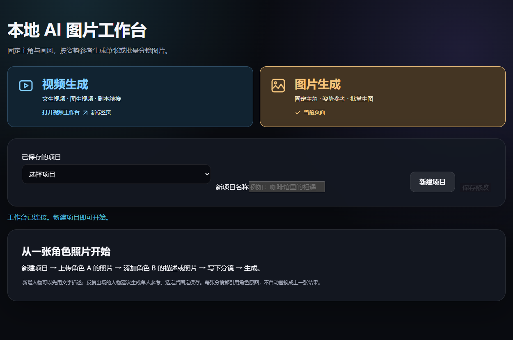

# 本地 AI 图像与视频工作台

一张角色参考图，一组姿势照片，一批分镜。这个免费的 Windows 工作台把图片和视频生成放到两个独立的中文页面：先在图片页固定主角、试姿势，再把满意的一张作为视频首帧。



## 可以拿它做什么？

| 想做的事 | 从哪里开始 |
| --- | --- |
| 让同一主角尝试不同姿势 | 图片生成 → 新建项目并固定角色参考 → 新建含该角色的分镜 → 在批量区域导入姿势图文件夹，把参考对象设为「姿势／构图参考」。每张参考单独生成，检查满意后再用作后续素材。 |
| 批量出图并保存到指定位置 | 在图片页选择「本次任务」的保存文件夹，在「本批次生成质量」选预览或精细，然后提交。比如先用预览跑两张，确认构图再扩大批次。项目中仍保留生成记录。 |
| 让一张分镜动起来 | 视频生成 → 图生视频 → 选择首帧并描述动作。也可从文字起步，或用上一段结尾续拍，再合并镜头。 |

固定角色图和姿势图分别控制身份与构图；不同角度、遮挡和多人镜头仍可能出现偏差。建议用一小组姿势先试。

## 下载与运行（Windows）

这是**源码版**。下载代码免费，不需要工作台账号或付费 API 密钥。实际生成使用本机 GPU；仓库不包含模型、ComfyUI 或 Python 整合环境。

1. 从绿色 **Code → Download ZIP** 下载并解压，或运行：
   ```powershell
   git clone https://github.com/maliaxtfws-wq/local-ai-image-video-workbench.git
   cd local-ai-image-video-workbench
   ```
2. 准备 Python 3.12 和工作台依赖。在项目目录打开 PowerShell：
   ```powershell
   py -3.12 -m venv .venv
   .\.venv\Scripts\python.exe -m pip install -r requirements.txt
   Copy-Item config.example.json config.json
   ```
3. 按[引擎配置指南](docs/setup.md)准备 ComfyUI、所需权重和节点，在 `config.json` 填好路径。**已有引擎和模型可以直接复用**。工作台启动时会连接或启动视频引擎，所以只体验图片页也要先配置视频引擎。
4. 运行：
   ```powershell
   .\.venv\Scripts\python.exe studio.py
   ```
   工作台会打开本机浏览器。视频入口是 `http://127.0.0.1:7860/`，图片入口是 `http://127.0.0.1:7860/storyboards`。从页面正常关闭工作台可释放它启动的引擎。启动本身不会提交生成任务。

## 数据和许可

默认项目记录与结果位于 `runtime/studio_data/`。图片页可为新任务另选导出目录。素材、结果、模型和个人配置不属于源代码；请仅在自己的电脑上运行此服务。

工作台原创代码采用 [MIT 许可证](LICENSE)。工作流来源及第三方许可见[来源说明](workflows/SOURCES.md)；模型与引擎须从各自上游取得，使用条件以对应许可为准。本项目是独立社区工具。

欢迎通过 [Issues](https://github.com/maliaxtfws-wq/local-ai-image-video-workbench/issues) 反馈问题。报告时请提供出错步骤、工作流和显卡型号，并隐去本机路径及私人素材。
